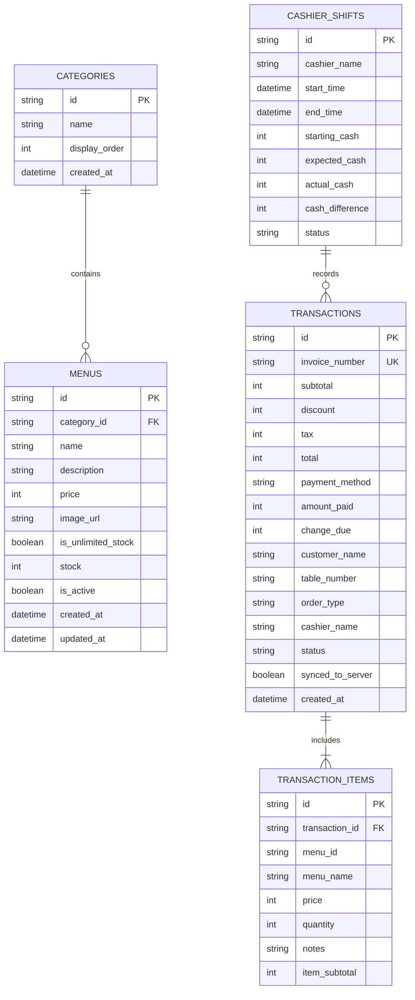

# 🗃️ Skema Basis Data & Entitas - KrisCafe

Dokumen ini mendefinisikan skema data untuk **Dexie.js (IndexedDB)** di sisi klien dan kompatibilitasnya dengan database relasional (SQLite / PostgreSQL) di sisi server.

---

## 1. Diagram Relasi Entitas (ERD)



---

## 2. Definisi Skema Dexie.js (TypeScript)

```typescript
import Dexie, { Table } from 'dexie';

export interface Category {
  id: string;
  name: string;
  display_order: number;
  created_at: string;
}

export interface MenuItem {
  id: string;
  category_id: string;
  name: string;
  description?: string;
  price: number;
  image_url?: string;
  is_unlimited_stock: boolean;
  stock: number;
  is_active: boolean;
  created_at: string;
  updated_at: string;
}

export interface TransactionItem {
  id: string;
  transaction_id: string;
  menu_id: string;
  menu_name: string;
  price: number;
  quantity: number;
  notes?: string;
  item_subtotal: number;
}

export interface Transaction {
  id: string;
  invoice_number: string;
  subtotal: number;
  discount: number;
  tax: number;
  total: number;
  payment_method: 'CASH' | 'QRIS' | 'TRANSFER';
  amount_paid: number;
  change_due: number;
  customer_name?: string;
  table_number?: string;
  order_type: 'DINE_IN' | 'TAKEAWAY';
  cashier_name: string;
  status: 'COMPLETED' | 'CANCELLED' | 'REFUNDED';
  synced_to_server: boolean;
  created_at: string;
}

export interface CashierShift {
  id: string;
  cashier_name: string;
  start_time: string;
  end_time?: string;
  starting_cash: number;
  expected_cash?: number;
  actual_cash?: number;
  cash_difference?: number;
  status: 'OPEN' | 'CLOSED';
}

export interface StoreSetting {
  key: string;
  value: string;
}

export class KrisCafeDatabase extends Dexie {
  categories!: Table<Category, string>;
  menus!: Table<MenuItem, string>;
  transactions!: Table<Transaction, string>;
  transaction_items!: Table<TransactionItem, string>;
  cashier_shifts!: Table<CashierShift, string>;
  settings!: Table<StoreSetting, string>;

  constructor() {
    super('KrisCafeDB');
    this.version(1).stores({
      categories: 'id, name, display_order',
      menus: 'id, category_id, name, is_active, is_unlimited_stock',
      transactions: 'id, invoice_number, payment_method, order_type, status, synced_to_server, created_at',
      transaction_items: 'id, transaction_id, menu_id',
      cashier_shifts: 'id, cashier_name, status, start_time',
      settings: 'key'
    });
  }
}

export const db = new KrisCafeDatabase();
```
