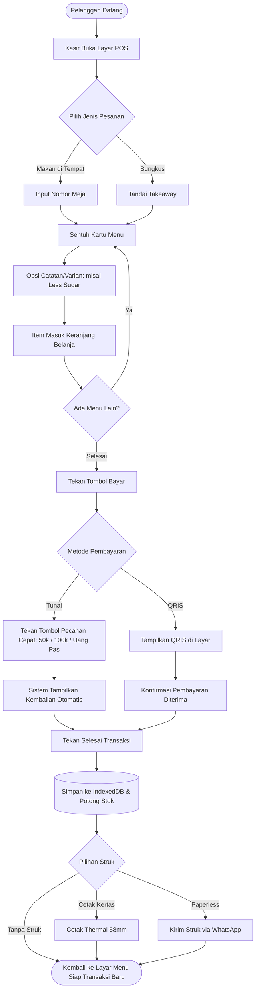
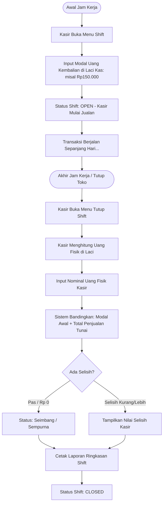

# 🧭 KrisCafe Master Blueprint & Implementation Plan

> **Dokumen Tunggal Sumber Kebenaran (Single Source of Truth)** untuk arsitektur, rencana bertahap, alur pengguna, konvensi teknis, dan *kickoff master prompt* KrisCafe POS.

---

## 📌 DAFTAR ISI
1. [Rencana Implementasi](#1-rencana-implementasi)
2. [Roadmap Per-Phase](#2-roadmap-per-phase)
3. [Penentuan MVP (Scope In vs Scope Out)](#3-penentuan-mvp-scope-in-vs-scope-out)
4. [Pembuatan User Flow](#4-pembuatan-user-flow)
5. [Penentuan State & Arsitektur Data](#5-penentuan-state--arsitektur-data)
6. [Penetapan Tech Stack & Konvensi Kode](#6-penetapan-tech-stack--konvensi-kode)
7. [Penyusunan Master Prompt (Kickoff)](#7-penyusunan-master-prompt-kickoff)

---

## 1. Rencana Implementasi

### 1.1 Filosofi Inti
* **Zero-Latency Touch Experience:** Kasir tidak boleh menunggu *loading spinner*. Seluruh aksi penambahan menu, hitung kembalian, dan simpan transaksi diselesaikan di bawah 50 milidetik secara lokal.
* **100% Offline-Resilient:** Operasional kafe tidak boleh berhenti saat sinyal internet down. Sistem mengadopsi prinsip *Local-First* menggunakan IndexedDB.
* **Ergonomi Layar Sentuh:** Menghilangkan risiko salah tekan (*fat-finger error*) dengan target sentuh minimal 44px x 44px dan tombol aksi utama minimal 52px.
* **Anti-AI Slop:** Menghindari tampilan klise murahan (gradien ungu neon, glassmorphism berat, layout generik). Desain menggunakan tema slate gelap bernuansa hangat (*warm dark palette*), tipografi bersih, dan kontras tinggi.

---

## 2. Roadmap Per-Phase

```
┌─────────────────┐     ┌─────────────────┐     ┌─────────────────┐
│     PHASE 0     │ ──► │     PHASE 1     │ ──► │     PHASE 2     │
│  Setup & Tokens │     │ Database Engine │     │ Touch POS Core  │
└─────────────────┘     └─────────────────┘     └─────────────────┘
                                                         │
                                                         ▼
┌─────────────────┐     ┌─────────────────┐     ┌─────────────────┐
│     PHASE 5     │ ◄── │     PHASE 4     │ ◄── │     PHASE 3     │
│  PWA & Android  │     │ Shift & Reports │     │ Checkout/Struk  │
└─────────────────┘     └─────────────────┘     └─────────────────┘
```

### Phase 0: Fondasi Proyek, Tooling & Design Tokens
* Inisialisasi Vite + React 19 + TypeScript.
* Konfigurasi design tokens di `src/styles/tokens.css` (warna, radius, spacing, typography).
* Setup base resets dan layout sentuh tablet/HP di `src/styles/global.css`.
* *Deliverable:* Halaman kosong dengan sistem token dan komponen dasar (*Button*, *Card*, *Badge*) yang teruji responsif.

### Phase 1: Database Klien (Local-First Dexie.js) & Seeding
* Instalasi dan inisialisasi Dexie.js di `src/db/kriscafe-db.ts`.
* Implementasi skema tabel: `categories`, `menus`, `transactions`, `transaction_items`, `cashier_shifts`, `settings`.
* Membuat seeder data awal: Kategori (*Coffee, Non-Coffee, Makanan, Camilan*) dan contoh menu kafe realistis dengan foto/aset.
* *Deliverable:* Database lokal terisi data menu awal yang dapat diakses instan secara offline.

### Phase 2: Layar Kasir Sentuh (Touch-First POS Core)
* Komponen `CategoryTabs` (filter kategori horizontal yang dapat digeser).
* Komponen `SearchBar` (pencarian nama menu instan).
* Komponen `MenuGrid` dan `MenuCard` (kartu menu responsif dengan indikator stok, status aktif, dan harga jelas).
* Komponen `CartDrawer` / `CartSidebar` (tampilan keranjang belanja 2 kolom di tablet, bottom-sheet di HP).
* State management keranjang belanja dengan **Zustand** (`src/store/cartStore.ts`).
* *Deliverable:* Kasir dapat memilih menu, mengubah jumlah, memasukkan catatan porsi, dan melihat subtotal secara real-time.

### Phase 3: Mesin Checkout, Kalkulator Kas Cepat & Cetak Struk
* Komponen `PaymentModal` dengan opsi metode pembayaran:
  * **Tunai:** Tombol pecahan uang instan (*Uang Pas, 10k, 20k, 50k, 100k*) dan kalkulator kembalian otomatis.
  * **QRIS:** Tampilan QR Code untuk di-scan oleh pembeli.
* Layanan cetak struk thermal 58mm/80mm menggunakan `@media print` CSS dan Web Print API.
* Layanan generator tautan WhatsApp Struk (`wa.me` generator) dengan format teks invoice rapi.
* Simpan transaksi sukses ke IndexedDB dan kurangi kuota stok porsi secara otomatis.
* *Deliverable:* Alur transaksi penuh dari pilih menu sampai cetak struk fisik atau kirim struk WhatsApp.

### Phase 4: Manajemen Stok, Rekap Shift & Laporan Harian
* Toggle "Stok Habis" langsung dari kartu menu atau dialog aksi cepat.
* Halaman Manajemen Menu sederhana: Tambah/edit menu, harga, dan kuota porsi.
* Alur Buka Kasir (*Open Shift*) dengan input modal awal di laci kasir.
* Alur Tutup Kasir (*Close Shift*) dengan perhitungan selisih uang tunai.
* Dashboard Laporan Ringkas: Total omzet hari ini, metode bayar (Tunai vs QRIS), dan 5 menu terlaris (*best sellers*).
* *Deliverable:* Pemilik kafe mendapatkan kontrol stok harian dan rekap keuangan yang akurat.

### Phase 5: PWA Offline-First & Android Packaging (Capacitor)
* Konfigurasi `vite-plugin-pwa` untuk Service Worker caching (Workbox) dan file `manifest.webmanifest`.
* Pengujian instalasi PWA (*Add to Home Screen*) di tablet Android.
* Integrasi **Capacitor.js** (`@capacitor/core`, `@capacitor/android`).
* Build aset produksi web dan sinkronisasi ke folder Android (`npx cap sync android`).
* *Deliverable:* File installer Android `.apk` yang siap di-install langsung di tablet kasir.

---

## 3. Penentuan MVP (Scope In vs Scope Out)

Agar proyek selesai tepat waktu dan memiliki stabilitas tinggi, batasan MVP didefinisikan secara tegas:

| Modul | Termasuk dalam MVP V1.0 (IN SCOPE) | Ditunda ke V2.0+ (OUT OF SCOPE) |
| :--- | :--- | :--- |
| **Katalog Menu** | Kategori, Nama, Harga, Foto, Kuota Porsi, Toggle Habis | Resep gramasi bahan mentah (misal: gram biji kopi, ml sirup) |
| **Kasir (POS)** | Dine-in/Takeaway, Nomor Meja, Catatan Pesanan, Keranjang Sentuh | Pemisahan tagihan kompleks (*Split bill* per item atau per orang) |
| **Pembayaran** | Tunai (kalkulator kembalian cepat) dan QRIS statis | Integrasi Payment Gateway dinamis otomatis (Midtrans/Xendit) |
| **Struk** | Cetak thermal 58mm/80mm via browser/Bluetooth & Struk WhatsApp | Pengiriman struk via SMS/Email berbayar |
| **Penyimpanan** | Offline-First IndexedDB lokal di perangkat kasir | Sinkronisasi multi-cabang cloud multi-tenant yang rumit |
| **Pengguna** | Mode Kasir & Mode Ringkasan Pemilik | Manajemen gaji staf (*payroll*) dan absensi sidik jari |

---

## 4. Pembuatan User Flow

### 4.1 Flow Utama Kasir (Rush Hour Transaction)



### 4.2 Flow Rekap Kasir (Buka Shift & Tutup Shift)



---

## 5. Penentuan State & Arsitektur Data

### 5.1 Hierarki Penyimpanan State

```
┌────────────────────────────────────────────────────────┐
│                      APLIKASI KRISCAFE                 │
├──────────────────────────┬─────────────────────────────┤
│   EPHEMERAL UI STATE     │     PERSISTENT DATA STATE   │
│       (Zustand)          │      (Dexie.js IndexedDB)   │
├──────────────────────────┼─────────────────────────────┤
│ • activeCategoryTab      │ • categories (master)       │
│ • cartItems []           │ • menus (katalog & stok)    │
│ • currentOrderType       │ • transactions (riwayat)    │
│ • paymentModalOpen       │ • transaction_items         │
│ • quickCashReceived      │ • cashier_shifts            │
│ • toastNotification      │ • store_settings            │
└──────────────────────────┴─────────────────────────────┘
```

### 5.2 Kontrak Tipe Data Utama (TypeScript)

```typescript
// 1. Model Menu & Stok
export interface MenuItem {
  id: string;
  categoryId: string;
  name: string;
  description?: string;
  price: number;              // Rupiah integer
  imageUrl?: string;
  isUnlimitedStock: boolean;
  stock: number;              // Sisa porsi
  isActive: boolean;
}

// 2. Model Item Keranjang
export interface CartItem {
  menuId: string;
  name: string;
  price: number;
  quantity: number;
  notes?: string;
}

// 3. Model Transaksi
export interface TransactionRecord {
  id: string;                 // Format: KC-YYYYMMDD-XXXX
  invoiceNumber: string;
  subtotal: number;
  total: number;
  paymentMethod: 'CASH' | 'QRIS' | 'TRANSFER';
  amountPaid: number;
  changeDue: number;
  customerName?: string;
  tableNumber?: string;
  orderType: 'DINE_IN' | 'TAKEAWAY';
  cashierName: string;
  createdAt: string;
  items: CartItem[];
}
```

---

## 6. Penetapan Tech Stack & Konvensi Kode

### 6.1 Konvensi Penamaan (Naming Conventions)
* **Komponen React:** `PascalCase` (contoh: `MenuGrid.tsx`, `PaymentModal.tsx`).
* **Custom Hooks:** `camelCase` berawalan `use` (contoh: `useCart.ts`, `useThermalPrinter.ts`).
* **Stores & Utilitas:** `camelCase` (contoh: `cartStore.ts`, `formatCurrency.ts`).
* **File Gaya / CSS:** `kebab-case.css` (contoh: `tokens.css`, `pos-layout.css`).
* **Konstanta:** `UPPER_SNAKE_CASE` (contoh: `DEFAULT_STORE_CONFIG`, `PAYMENT_METHODS`).

### 6.2 Aturan CSS & Anti-Slop Styling
* **Murni CSS Variables / Design Tokens:** Tidak menggunakan class inline acak. Seluruh warna, padding, dan radius mengacu pada variabel di `tokens.css`.
* **Dark Slate Theme:** Background `#0F1115`, Surface `#181B20`, Border `#2C323B`, Aksen Caramel/Amber `#E08A3C`.
* **Touch Target Mandatory:** Setiap elemen interaktif memiliki `min-height: 44px` dan `min-width: 44px`.

### 6.3 Standar Pesan Git Commit (Conventional Commits)
* `feat:` Penambahan fitur baru (misal: `feat: implementasi kalkulator bayar cepat di modal pembayaran`).
* `fix:` Perbaikan bug (misal: `fix: perbaiki hitungan kembalian pada pembayaran uang pas`).
* `refactor:` Perubahan struktur kode tanpa mengubah fungsionalitas.
* `docs:` Pembaruan dokumentasi.
* `style:` Penyesuaian tampilan CSS dan tokens.

---

## 7. Penyusunan Master Prompt (Kickoff)

Gunakan Master Prompt di bawah ini setiap kali memulai atau melanjutkan pengembangan teknis KrisCafe agar AI assistant tetap patuh pada standar arsitektur:

```markdown
### 🚀 MASTER KICKOFF PROMPT - KRISCAFE DEVELOPMENT

Act as a Principal Full-Stack Web Engineer, System Architect, and Expert UI/UX Designer adhering strictly to the KrisCafe guidelines in `brain.md` and `docs/MASTER_PLAN.md`.

You are developing **KrisCafe**, a modern, touch-first, offline-first web POS application for canteens and cafes.

### STRICT RULES:
1. **Tech Stack:** React 19 + TypeScript + Vite 6 + Vanilla CSS Tokens + Dexie.js (IndexedDB) + Zustand + Capacitor.js.
2. **Anti-AI Slop UI/UX:**
   - NO generic purple/blue gradients or heavy glassmorphism.
   - Use the curated Warm Dark Slate palette (#0F1115, #181B20, accent #E08A3C).
   - Ensure all interactive buttons have at least 44px touch targets.
   - Design for tablets and smartphones.
3. **Execution Protocol:**
   - Follow the Phased Roadmap from `docs/MASTER_PLAN.md`.
   - Never write massive broken files. Provide atomic, clean, well-tested code.
   - Keep state zero-latency local-first using Dexie.js for persistence and Zustand for UI state.

Please confirm that you have read this directive and proceed with the current step.
```
