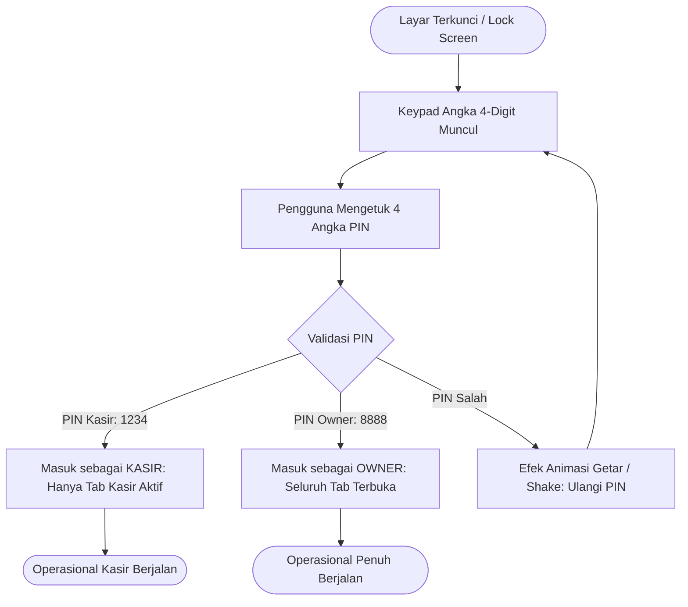
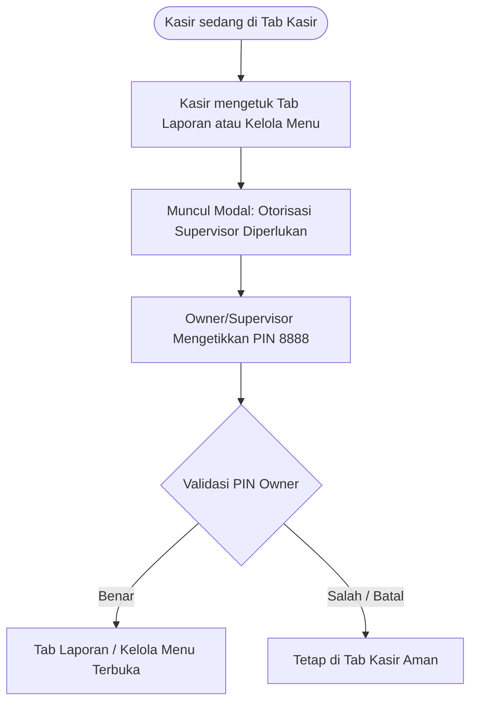

# 🔐 Rencana Implementasi: Keamanan, Quick PIN Auth & Role-Based Guard (Owner vs Kasir)

> **Dokumen Perencanaan Arsitektur & Keamanan** untuk aplikasi KrisCafe POS.
> Menggunakan metode **Quick PIN 4-Digit (Local-First)** yang cepat, aman, dan dirancang khusus untuk kenyamanan layar sentuh tablet/HP kasir.

---

## 1. Analisis Kebutuhan & Filosofi Keamanan

### 1.1 Masalah di Lapangan (Kantin / Kafe Sederhana)
* Tablet kasir adalah perangkat bersama (*shared device*).
* Login menggunakan Email + Password rumit **sangat tidak cocok** untuk operasional POS karena memperlambat antrean saat jam sibuk dan kasir cenderung menempelkan password di meja kasir.
* Tanpa proteksi, siapa saja (staf part-time, teman kasir, atau pelanggan iseng) bisa melihat total omzet toko atau mengubah harga menu.

### 1.2 Solusi: Quick PIN 4-Digit + Role Guard
* **Kecepatan Masuk:** 1 - 2 detik menggunakan keypad angka layar sentuh.
* **100% Offline-First:** Berjalan secara lokal di IndexedDB tanpa dependensi internet server.
* **Separation of Roles:**
  * **Role KASIR:** Bebas bertransaksi di tab Kasir, dilarang mengakses omzet & dilarang mengedit harga.
  * **Role OWNER:** Akses tak terbatas (Laporan Keuangan, Buka/Tutup Shift, Kelola Menu & Stok).

---

## 2. Matriks Hak Akses (Role-Based Access Matrix)

| Fitur / Halaman | Kasir (Staff) | Owner (Pemilik) | Mekanisme Proteksi |
| :--- | :---: | :---: | :--- |
| **Tab Kasir (POS Core)** | ✅ Bebas | ✅ Bebas | Langsung terbuka untuk melayani antrean |
| **Kalkulator & Cetak Struk** | ✅ Bebas | ✅ Bebas | Operasional normal |
| **Buka Shift (*Open Shift*)** | ✅ Bebas | ✅ Bebas | Kasir memasukkan modal awal kembalian |
| **Tab Laporan Omzet & Keuangan** | ❌ Dibatasi | ✅ Bebas | Meminta PIN Owner saat diklik |
| **Tutup Shift Kasir (*Reconcile*)**| ❌ Dibatasi | ✅ Bebas | Mencegah manipulasi uang kas fisik laci |
| **Tab Kelola Menu (Edit Harga/Nama)**| ❌ Dibatasi | ✅ Bebas | Meminta PIN Owner saat diklik |
| **Pengaturan & Ganti PIN** | ❌ Dibatasi | ✅ Bebas | Hanya bisa diubah oleh Owner |

---

## 3. Alur Kerja Pengguna (User Flow)

### 3.1 Alur Kunci Layar & Masuk PIN (Lock Screen)



### 3.2 Alur Role Guard pada Tab Sensitif



---

## 4. Arsitektur Data & State Management

### 4.1 Penyimpanan Permanen di IndexedDB (`settings` table)
* `auth_cashier_pin`: Default `'1234'`
* `auth_owner_pin`: Default `'8888'`
* `auth_auto_lock`: Default `'5'` (menit) atau `'0'` (nonaktif)

### 4.2 State Reaktif di Zustand (`src/store/authStore.ts`)
```typescript
export type UserRole = 'CASHIER' | 'OWNER';

export interface UserSession {
  role: UserRole;
  name: string;
  loginTime: string;
}

interface AuthStore {
  currentSession: UserSession | null;
  isScreenLocked: boolean;
  
  // Actions
  unlockWithPin: (pin: string) => Promise<{ success: boolean; role?: UserRole; message?: string }>;
  lockScreen: () => void;
  logout: () => void;
  verifyOwnerPin: (pin: string) => Promise<boolean>;
  changePins: (type: 'CASHIER' | 'OWNER', oldPin: string, newPin: string) => Promise<boolean>;
}
```

---

## 5. Rencana Tahapan Kerja (Action Plan Bertahap)

### Tahap 1: Persiapan Database & Store Auth
* Menambahkan konfigurasi default PIN (`1234` dan `8888`) ke dalam seeder IndexedDB.
* Membuat `src/store/authStore.ts` untuk mengelola sesi login, status gembok layar, dan validasi PIN.

### Tahap 2: Komponen Keypad Angka Sentuh (`PinKeypadModal`)
* Membuat antarmuka keypad angka layar sentuh:
  * Tombol angka sentuh besar (min 56px x 56px) untuk kenyamanan jari.
  * 4 indikator dot bulatan PIN yang menyala saat angka diketik.
  * Tombol `C` (Clear) dan `⌫` (Backspace).
  * Animasi getar halus (*shake feedback*) saat salah memasukkan PIN.

### Tahap 3: Implementasi Lock Screen & Role Guard di Halaman POS
* Menambahkan tombol gembok (*Quick Lock*) di topbar: kasir bisa mengunci layar dalam 1 ketukan saat meninggalkan meja.
* Menambahkan *Supervisor Guard* pada tombol navigasi **"Laporan & Shift"** dan **"Kelola Menu"**: jika pengguna saat ini berstatus Kasir, muncul dialog PIN Owner untuk membukanya.

### Tahap 4: Modal Pengaturan & Ubah PIN
* Dialog pengaturan bagi Owner untuk mengubah PIN Kasir atau PIN Owner sendiri sewaktu-waktu.

### Tahap 5: Verifikasi di Browser & Push ke GitHub
* Uji coba login dengan PIN Kasir (`1234`) -> pastikan hanya tab Kasir yang bisa diakses.
* Uji coba buka Laporan -> verifikasi popup PIN Owner muncul.
* Uji coba login dengan PIN Owner (`8888`) -> pastikan semua menu terbuka.
* Build produksi & push ke GitHub.

---

## 6. Nilai Tambah bagi Pemilik Kafe

1. **Anti-Kecurangan:** Staf kasir tidak bisa diam-diam menurunkan harga makanan atau memanipulasi stok.
2. **Kerahasiaan Omzet Terjamin:** Pelanggan yang sedang berada di depan meja kasir atau staf kasir tidak bisa mengintip total pendapatan harian kafe.
3. **Penyelarasan Shift Akurat:** Pemilik kafe yang mengesahkan penutupan shift dan memeriksa uang kas fisik di laci kasir.
